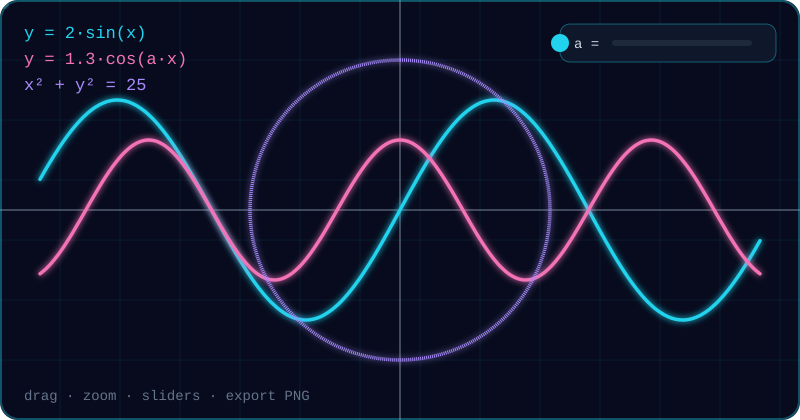
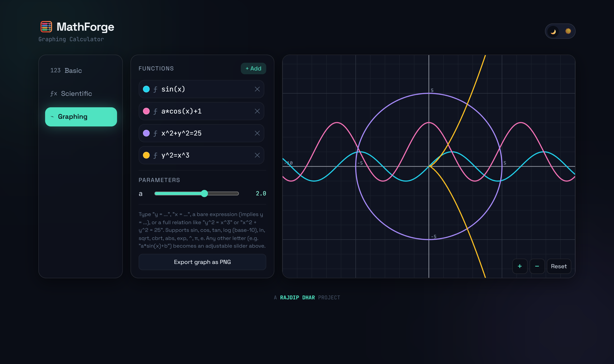
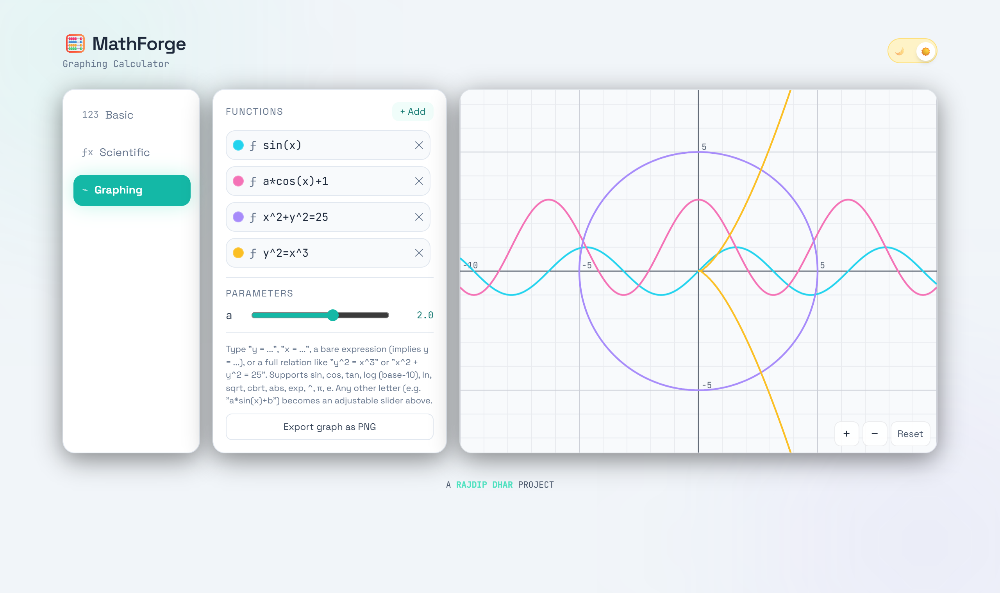

<div align="center">


<br/>

<a href="https://github.com/RajdipDhar2007/MathForge">
  
</a>

<br/>

[](https://react.dev/)
[](https://www.typescriptlang.org/)
[](https://vitejs.dev/)
[](https://tailwindcss.com/)
[](https://mathjs.org/)
[](LICENSE)

<br/>

</div>

<br/>

## 🎬 See it in action

<div align="center">
  
  <br/><sub><i>Sine, a slider-driven cosine, and the implicit circle <code>x² + y² = 25</code> — all plotted live on a raw HTML5 Canvas.</i></sub>
</div>

<br/>

## 📸 Screenshots

<div align="center">
  
  <br/><sub><i>Graphing — multiple equations, an auto-generated slider for <code>a</code>, and implicit curves.</i></sub>
</div>

<br/>

<table>
<tr>
<td width="50%" align="center"><br/><sub><b>Scientific</b> — live evaluation + history</sub></td>
<td width="50%" align="center"><br/><sub><b>Calculus</b> — symbolic d/dx, integrals, signum</sub></td>
</tr>
<tr>
<td width="50%" align="center"><br/><sub><b>Light theme</b> — one click, fully persisted</sub></td>
<td width="50%" align="center"><br/><sub><b>Mobile</b> — tab bar layout</sub></td>
</tr>
</table>

<br/>

## ✨ Why MathForge?

<table>
<tr>
<td width="50%" valign="top">

### 🔢 Basic
Everyday arithmetic with memory keys **MC / MR / M+ / M−**, wrapped in a glassy, responsive keypad.

### 🧪 Scientific
Trig, logs, powers, roots, factorial, `|x|`, `π`, `e`, a **Deg/Rad** toggle, and real operator precedence thanks to a live math.js parser.

</td>
<td width="50%" valign="top">

### 📈 Graphing
Multi-function plotting, **implicit relations** like `y² = x³`, pan, zoom, hover coordinates, saved equations and **PNG export**.

### ∫ Calculus
Symbolic derivatives, numeric definite integrals, term-by-term indefinite integrals, and an exact **signum solver**.

</td>
</tr>
</table>

<div align="center">

| 🌗 Dark / Light | ⌨️ Full keyboard | 💾 Persistent | 📱 Responsive | 🛡️ Crash-proof |
|:---:|:---:|:---:|:---:|:---:|
| Animated slider toggle | Type, arrows, Enter, Esc | Theme, mode, history, graphs | Rail on desktop, tabs on mobile | Readable inline errors |

</div>

<br/>

## 🧠 The cool engineering bits

<details open>
<summary><b>📐 A from-scratch graphing engine (no chart library)</b></summary>
<br/>

`GraphCanvas.tsx` draws straight onto the Canvas 2D API. Each equation is compiled by `compileGraphExpression` into one of three shapes:

| Form | Strategy |
|---|---|
| `y = f(x)` | single sweep, one sample per pixel column |
| `x = f(y)` | single sweep, one sample per pixel row |
| anything else (`x² + y² = 25`, `y² = x³`) | **marching squares** on the zero contour of `left(x,y) − right(x,y)` |

Grid spacing snaps to "nice numbers" (1 / 2 / 5 × 10ⁿ) as you zoom.

</details>

<details>
<summary><b>🎚️ Auto-generated sliders</b></summary>
<br/>

Write `a*sin(x) + b` and MathForge spots `a` and `b`, then spawns a labelled slider for each. Any number of parameters, across any number of equations, updating the plot as you drag.

</details>

<details>
<summary><b>∫ A calculus toolkit that is honest about its limits</b></summary>
<br/>

- **Differentiation** — fully symbolic, any order, via math.js `derivative()`.
- **Definite integration** — composite Simpson's rule with expression limits like `pi/2`; works even with no closed-form antiderivative.
- **Indefinite integration** — scoped symbolic integrator (power rule, sin, cos, exp, 1/x, √x). Unsupported terms are reported, never guessed.
- **Signum solving** — ∫ sign(f(x)) dx by locating every zero-crossing (fine scan + bisection) and summing signed segment lengths exactly.

All calculus runs in radians; `log` is base-10 everywhere (rewritten to `ln(x)/ln(10)` internally).

</details>

<details>
<summary><b>🎯 Calculator correctness details</b></summary>
<br/>

- **Expression-based engine** — a full expression is re-evaluated on every keystroke, so precedence and nesting are mathematically correct instead of left-to-right chaining.
- **Deg/Rad** — `sin`, `cos`, `tan` and inverses are rebound in the evaluation scope.
- **`log` vs `ln`** — `log` is base-10, `ln` is natural (vanilla math.js differs).
- **Auto-closing brackets** — pressing `sin` types `sin(|)` with the caret inside. The display is a real text input with caret tracking.
- **Nested expressions** — `(3*nthRoot(6,4)/2) + sqrt(2)` just works.

</details>

<br/>

## 🚀 Quick start

> Requires **Node.js 18+**

```bash
git clone https://github.com/RajdipDhar2007/MathForge.git
cd MathForge
npm install
npm run dev        # → http://localhost:5173
```

| Command | What it does |
|---|---|
| `npm run dev` | start the dev server |
| `npm run build` | type-check and build to `dist/` |
| `npm run preview` | preview the production build |
| `npm run lint` | run ESLint |

<br/>

## 🗂️ Project map

```text
src/
├── components/   Basic · Scientific · Graphing · Calculus · Sidebar · Display · History
├── hooks/        useCalculatorEngine · useLocalStorage
├── context/      ThemeContext
├── utils/        mathEngine.ts   ← parsing, graph compiling, calculus
└── types/
```

<br/>

## 🤝 Contributing

Ideas, bugs and PRs are all welcome.

1. Fork the repo
2. `git checkout -b feature/your-feature`
3. `git commit -m "Add some feature"`
4. `git push origin feature/your-feature`
5. Open a pull request

Please run `npm run lint` and `npm run build` first.

<br/>

## 🌟 Support the project

If MathForge saved you a trip to a graphing calculator, helped you study, or just looked cool:

<div align="center">

**⭐ Star it &nbsp;·&nbsp; 🍴 Fork it &nbsp;·&nbsp; 📣 Share it &nbsp;·&nbsp; 🐛 Report a bug**

</div>

<br/>

## 📄 License

Released under the **MIT License** — see [`LICENSE`](./LICENSE).

<br/>

---

<div align="center">


<br/>

**A [RAJDIP DHAR](https://github.com/RajdipDhar2007) PROJECT** &nbsp;·&nbsp; If MathForge helped you, a ⭐ on the repo is the best thank-you.

</div>
